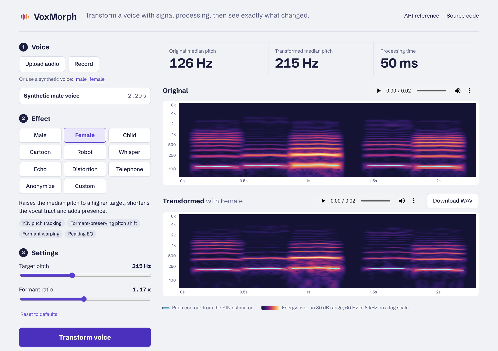
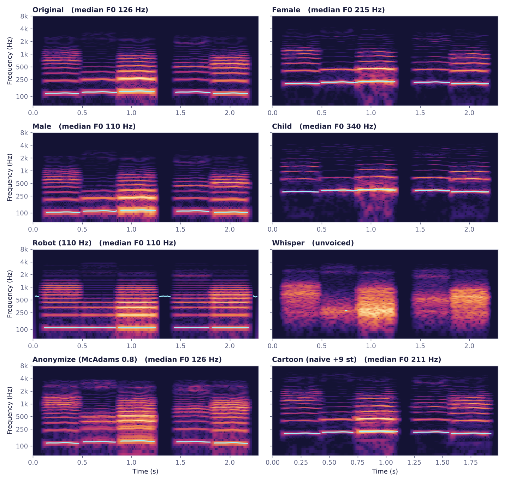
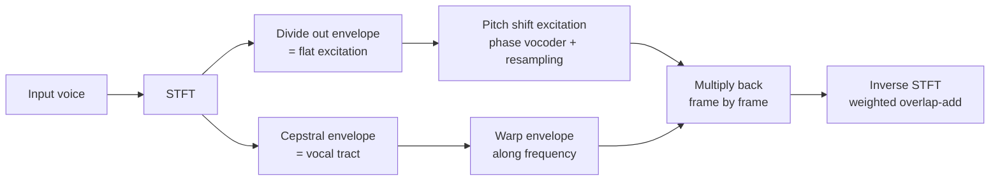
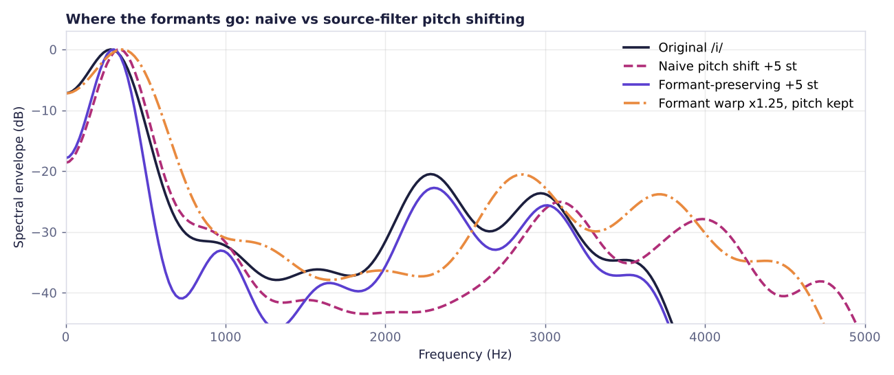

# VoxMorph

[](https://github.com/Fa-riya/voxmorph/actions/workflows/ci.yml)


**Voice transformation with classic digital signal processing.** VoxMorph changes how a voice sounds (gender, age, robot, whisper, anonymised and more) and shows exactly what changed, with side-by-side spectrograms and pitch contours.

The DSP core is written from first principles in NumPy and SciPy: STFT and overlap-add, a phase vocoder, YIN pitch tracking, cepstral source-filter separation, Levinson-Durbin linear prediction and hand-derived biquad filters. It is served by a FastAPI backend and a React interface, and every algorithm is covered by tests that check its behaviour against theory.



## Highlights

- **Independent pitch and formant control.** A source-filter split in the STFT domain shifts pitch while keeping (or separately warping) the vocal-tract resonances, avoiding the "chipmunk" sound of naive pitch shifting.
- **Adaptive presets.** The gender and age effects measure the speaker's median F0 with YIN and shift towards a *target pitch*, so a deep voice and a high voice both land in the right register.
- **Speaker anonymisation.** The McAdams-coefficient method, the signal-processing baseline of the [VoicePrivacy Challenge](https://www.voiceprivacychallenge.org/), warps the angles of LPC poles to change who the speaker sounds like while keeping what they say.
- **Fast.** Every effect processes 10 seconds of speech in under 0.3 s on two CPU cores (35x faster than real time or better).
- **Measured, not just listened to.** 51 tests check pitch-tracking accuracy, perfect STFT reconstruction, formant positions after shifting, LPC against a Toeplitz solver, and the full API.

## Effects

| Effect | What it does | DSP behind it |
| --- | --- | --- |
| **Male** | Lower pitch, longer vocal tract, warmer low end | YIN pitch target, formant-preserving pitch shift, formant warp (x0.86), low-shelf EQ |
| **Female** | Higher pitch, shorter vocal tract, more presence | YIN pitch target, formant-preserving pitch shift, formant warp (x1.17), peaking EQ at 3.2 kHz |
| **Child** | High pitch with strongly raised formants | YIN pitch target, formant-preserving pitch shift, formant warp (x1.3) |
| **Cartoon** | Squeaky, sped-up voice | *Naive* pitch shift (phase vocoder + polyphase resampling), time stretch, tremolo |
| **Robot** | Perfectly monotone, buzzy voice | STFT envelope with zeroed phase, resynthesised at a fixed hop, ring modulation |
| **Whisper** | Breathy, unvoiced speech | STFT phase randomisation (keeps the envelope, destroys the harmonics) |
| **Echo** | Repeats that fade and darken | Feedback delay line with one-pole low-pass damping |
| **Distortion** | Overdriven, gritty voice | Asymmetric `tanh` waveshaper at 4x oversampling, band limiting |
| **Telephone** | Narrowband phone-line sound | 300-3400 Hz Butterworth band-pass, compressor, soft clipper |
| **Anonymize** | Different-sounding speaker, same words | LPC (Levinson-Durbin), McAdams pole-angle warp, overlap-add resynthesis |
| **Custom** | Any pitch, formant and speed combination | The three building blocks behind every preset |

Every effect has adjustable parameters with validated ranges (`GET /api/effects` lists them).



## How the core works

Speech can be modelled as an **excitation** (the vocal folds, which set the pitch) filtered by the **vocal tract** (which sets the formants, and with them vowel identity and much of a speaker's character). VoxMorph separates the two in every STFT frame:



Because pitch and formants are handled separately, "raise the pitch by 5 semitones" no longer drags the formants up with it, and "make the vocal tract 25% shorter" no longer changes the pitch:



The full write-up, with equations for each algorithm, is in [docs/DSP.md](docs/DSP.md).

## Quick start

### Docker (one command)

```bash
docker build -t voxmorph .
docker run -p 8000:8000 voxmorph
```

Open http://localhost:8000 for the app and http://localhost:8000/docs for the interactive API reference.

### Local development

Requirements: Python 3.10+ and Node.js 18+.

```bash
# Backend
python -m venv .venv
source .venv/bin/activate          # Windows: .venv\Scripts\activate
pip install -e ".[dev]"
uvicorn voxmorph.api:app --reload  # http://localhost:8000

# Frontend (second terminal)
cd frontend
npm install
npm run dev                        # http://localhost:5173, forwards /api to :8000
```

To serve everything from FastAPI instead, run `npm run build` in `frontend/`. The backend picks up `frontend/dist` automatically.

### Command line

```bash
voxmorph --list                                   # effects and their parameters
voxmorph speech.wav -e female                     # writes speech_female.wav
voxmorph speech.wav -e custom -p semitones=-3 -p formant=0.9 -o deeper.wav
voxmorph speech.wav -e anonymize -p alpha=0.75
```

### Python

```python
from voxmorph import apply_effect, load_audio, save_audio

x, sr = load_audio("speech.wav")  # mono, 22.05 kHz
y = apply_effect(x, sr, "custom", {"semitones": 4, "formant": 1.0})
save_audio("higher_same_formants.wav", y, sr)
```

## API

| Method | Endpoint | Description |
| --- | --- | --- |
| `GET` | `/api/health` | Service status and version |
| `GET` | `/api/effects` | Effects with descriptions, techniques and parameter ranges |
| `POST` | `/api/process` | Multipart `file`, `effect` and optional JSON `params`; returns a 16-bit WAV |
| `POST` | `/api/analyze` | Log-frequency spectrogram, YIN pitch contour and level statistics |
| `GET` | `/api/sample?speaker=male` | A synthetic test voice (source-filter synthesiser) |

```bash
curl -F file=@speech.wav -F effect=custom -F 'params={"semitones": 3}' \
     http://localhost:8000/api/process -o out.wav
```

The API is stateless: audio arrives with the request and the result goes straight back, so nothing is written to disk. Uploads are limited to 15 MB and 60 seconds.

## Project structure

```
voxmorph/
├── src/voxmorph/
│   ├── dsp/
│   │   ├── spectral.py      # STFT/ISTFT, phase vocoder, cepstral envelope, frequency warping
│   │   ├── pitch.py         # YIN F0 estimator with octave-error correction
│   │   ├── transforms.py    # time stretch, pitch shift, source-filter pitch/formant shift
│   │   ├── lpc.py           # autocorrelation LPC, Levinson-Durbin, McAdams anonymisation
│   │   ├── filters.py       # RBJ biquads (peaking, shelving), Butterworth helpers
│   │   ├── dynamics.py      # compressor, soft clipper, normalisation
│   │   └── creative.py      # robot, whisper, echo, distortion, modulation
│   ├── effects.py           # effect catalogue, parameter specs and validation
│   ├── analysis.py          # spectrogram + pitch data for the UI
│   ├── synth.py             # Rosenberg-pulse formant synthesiser for tests and demos
│   ├── audio_io.py          # decoding, resampling, WAV encoding
│   ├── api.py               # FastAPI app
│   └── __main__.py          # command-line interface
├── frontend/                # React + Vite interface
├── tests/                   # pytest suite
├── scripts/make_figures.py  # regenerates the figures in docs/images
└── docs/DSP.md              # algorithm write-up
```

## Testing

```bash
pytest           # 51 tests, about 2 seconds
ruff check .     # lint
```

The tests check behaviour rather than just "it runs". Among them:

- YIN reads harmonic tones from 70 to 500 Hz to within 0.5%, and marks noise and silence as unvoiced.
- STFT followed by ISTFT reconstructs the signal to machine precision, including hop sizes that do not divide the frame length.
- Pitch shifts land within 1% of the target, and time stretching changes duration without changing pitch.
- A formant-preserving +5 semitone shift keeps F2 of /i/ within 3%, while a naive shift moves it by the predicted 2^(5/12).
- Levinson-Durbin matches SciPy's Toeplitz solver, and the McAdams warp moves F2 to within 3% of the value the formula predicts.
- The gender presets hit their target pitch, the robot's pitch equals its hop rate, and whispering removes voicing.

## Design notes

- **NumPy/SciPy instead of a black-box audio library.** Writing the STFT, phase vocoder and pitch tracker directly keeps every step inspectable, and drops heavy dependencies such as `librosa`/`numba`, so the package installs cleanly on Python 3.13.
- **22.05 kHz internally.** Speech energy sits well below 11 kHz, and halving the sample rate roughly halves processing time.
- **Browser-side decoding.** The frontend decodes any format the browser supports, including microphone recordings, and uploads compact 22.05 kHz mono WAV, so the server handles a single format.
- **Synthetic test voice.** A small source-filter synthesiser provides reproducible test signals with known pitch and formants, without shipping anyone's real voice.

## Limitations and next steps

- Processing is offline (whole clips). A streaming version over WebSockets with block-based STFT would allow live use.
- The phase vocoder has no phase locking, so large shifts can sound slightly "phasey". Identity phase locking (Laroche & Dolson) or PSOLA for voiced segments would improve quality.
- The cepstral envelope is a simple estimator. A true-envelope or LPC-based envelope would track formants of high-pitched voices more accurately.
- A natural extension is comparing these DSP baselines with neural voice conversion and measuring speaker similarity, for example with speaker-embedding cosine distance.

## References

- A. de Cheveigné and H. Kawahara, "YIN, a fundamental frequency estimator for speech and music," *JASA*, 2002.
- U. Zölzer (ed.), *DAFX: Digital Audio Effects*, 2nd ed., Wiley, 2011 (phase vocoder, robotisation, whisperisation).
- J. Laroche and M. Dolson, "Improved phase vocoder time-scale modification of audio," *IEEE TSAP*, 1999.
- J. Patino et al., "Speaker anonymisation using the McAdams coefficient," *Interspeech*, 2021.
- R. Bristow-Johnson, "Cookbook formulae for audio EQ biquad filter coefficients."
- G. E. Peterson and H. L. Barney, "Control methods used in a study of the vowels," *JASA*, 1952.

## Background

VoxMorph grew out of a Digital Signal Processing lab project at the Islamic University of Technology (IUT), built with Rumman Adib and Nayeem Fardin Rohan. This repository is a ground-up rewrite with a new DSP core, API, interface and test suite.

## License

[MIT](LICENSE)
