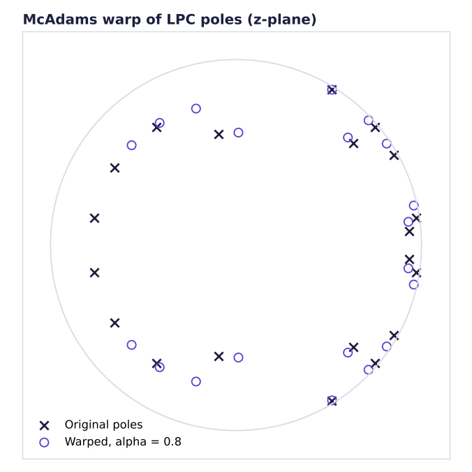

# The signal processing in VoxMorph

This document explains each algorithm in `src/voxmorph/dsp`, in the order the effects depend on them. All audio is processed as mono at $f_s = 22050$ Hz.

## 1. Short-time Fourier transform (`spectral.py`)

The signal is cut into overlapping frames of $N = 1024$ samples (46 ms) every $H = 256$ samples, each multiplied by a periodic Hann window $w[n]$ and transformed:

$$X[k, m] = \sum_{n=0}^{N-1} x[n + mH]\, w[n]\, e^{-j 2\pi k n / N}$$

Resynthesis uses **weighted overlap-add**: each inverse-transformed frame is windowed again, summed into place, and the result is divided by $\sum_m w^2[n - mH]$. Dividing by the actual window sum (rather than assuming a constant) makes reconstruction exact for *any* hop size, which the robot effect relies on, because its hop is set by the desired robot pitch. The tests confirm reconstruction to machine precision.

## 2. Phase vocoder time stretching

To change duration by a factor $1/r$, output frames are taken at fractional input positions $t = 0, r, 2r, \dots$. Magnitudes are interpolated linearly between the two neighbouring frames. Phases cannot simply be interpolated: each bin's phase must advance by its true instantaneous frequency. For bin $k$, the expected advance per hop is $\omega_k H = 2\pi k H / N$, and the measured deviation is

$$\Delta\phi_k = \text{princarg}\big(\angle X[k, m+1] - \angle X[k, m] - \omega_k H\big)$$

The synthesis phase is accumulated as $\phi_k \leftarrow \phi_k + \omega_k H + \Delta\phi_k$, which keeps every partial continuous across the new frame grid.

## 3. Pitch shifting

A pitch shift by $s$ semitones uses $r = 2^{s/12}$:

1. time-stretch by $r$ with the phase vocoder (duration $\times r$, pitch unchanged),
2. resample by $1/r$ with a polyphase FIR (`scipy.signal.resample_poly`), which restores the duration and scales every frequency by $r$.

This scales *everything* by $r$, harmonics and formants alike. That is what the **Cartoon** effect deliberately does.

## 4. Source-filter separation and formant control (`transforms.py`)

The **real cepstrum** of a frame is the inverse FFT of its log magnitude spectrum:

$$c[q] = \mathcal{F}^{-1}\{\log |X[k]|\}$$

In speech, the vocal-tract response varies slowly across frequency and lands in low quefrencies, while the harmonic excitation shows up as a peak at the pitch period. Keeping only $q < L$ (with $L \approx 1.8$ ms, below the period of voices up to about 550 Hz) and transforming back gives the smooth **spectral envelope** $E[k]$.

`pitch_formant_shift` then works in three steps:

1. **Whiten:** $X / E$ removes the vocal tract and leaves a flat excitation that keeps the original phase.
2. **Shift the excitation** with the phase-vocoder pitch shift from section 3.
3. **Re-colour:** multiply each frame by the original envelope, optionally warped along frequency: $E'[k] = E[k / \beta]$. A factor $\beta > 1$ models a shorter vocal tract (child or female), $\beta < 1$ a longer one.

With $\beta = 1$ this is a **formant-preserving pitch shift**. With $s = 0$ it changes only the formants. On the vowel /i/ (F2 at about 2290 Hz), a naive +5 semitone shift moves F2 to about 3050 Hz, while the formant-preserving shift keeps it within 3% of the original (see `tests/test_dsp.py` and `docs/images/formant_shift.png`).

## 5. YIN pitch estimation (`pitch.py`)

For each frame the **difference function** is

$$d(\tau) = \sum_{j=0}^{W-1} (x_j - x_{j+\tau})^2 = r_0 + r_\tau - 2\sum_j x_j x_{j+\tau}$$

The energy terms come from cumulative sums and the cross term from one FFT cross-correlation per frame, so all frames are computed at once. The **cumulative mean normalised difference**

$$d'(\tau) = \frac{d(\tau)}{\frac{1}{\tau}\sum_{i=1}^{\tau} d(i)}, \qquad d'(0) = 1$$

removes the bias towards $\tau = 0$. The period is the first dip below a threshold (0.15), refined to sub-sample precision with parabolic interpolation. Two corrections handle YIN's typical failures:

- **Missing-fundamental guard:** if the chosen dip is shallow and $d'(2\tau)$ is much deeper, the estimator caught the period of the second harmonic, so it takes $2\tau$. This happens after band-limiting, as in the Telephone effect.
- **Octave smoothing:** frames that sit about one octave from the median of their voiced neighbours are folded back by an octave.

Frames more than 40 dB below the loudest frame are marked unvoiced. The **adaptive presets** use the median voiced F0 to compute the shift towards a target: $s = 12 \log_2(f_{\text{target}} / \tilde f_0)$.

## 6. Linear prediction and McAdams anonymisation (`lpc.py`)

Each 20 ms frame (10 ms hop) is modelled as all-pole: $x[n] \approx -\sum_{k=1}^{p} a_k x[n-k]$ with $p = 20$. The coefficients solve the Yule-Walker equations $R\,a = -r$, where $R$ is Toeplitz. They are found in $O(p^2)$ with the **Levinson-Durbin** recursion, written out directly and checked against `scipy.linalg.solve_toeplitz`.

The frame is inverse-filtered by $A(z)$ to obtain the **residual** (excitation). The roots of $A(z)$ are the poles of the vocal-tract filter. Each complex pole at angle $\phi$ (radians) is moved to

$$\phi' = \phi^{\alpha}, \qquad \alpha \approx 0.8$$

keeping its radius, so the filter stays stable. Low formants move up and high ones move down, which changes the perceived speaker identity. The residual, and therefore the words and prosody, is resynthesised through the warped filter and overlap-added. This is the McAdams-coefficient baseline from the VoicePrivacy Challenge.

## 7. Creative effects (`creative.py`)

- **Robot:** each STFT frame is replaced by its cepstral envelope with zero phase (a symmetric pulse that carries only the formants), centred in the window by a linear phase $(-1)^k$, and overlap-added at a hop of $f_s / f_{\text{robot}}$ samples. The output pitch *is* the hop rate, whatever the input pitch was.
- **Whisper:** short frames (23 ms) keep $|X|$ but get uniformly random phase, replacing the periodic glottal source with noise shaped by the same vocal tract.
- **Echo:** repeats at $kD$ samples, each scaled by $g^k$ and passed through a one-pole low-pass $y[n] = (1-p)x[n] + p\,y[n-1]$ once more, so later echoes are both quieter and darker.
- **Distortion:** $y = \tanh(G x + b) - \tanh(b)$. The bias $b$ makes the curve asymmetric, which adds even harmonics. The nonlinearity runs at 4x the sample rate so the harmonics it creates above the original Nyquist are removed by the decimation filter instead of folding back as aliasing.

## 8. Filters and dynamics (`filters.py`, `dynamics.py`)

- **Biquads** (peaking EQ, low and high shelf) use the RBJ Audio EQ Cookbook formulas, written out explicitly.
- **Butterworth** band-, high- and low-pass filters run forward and backward (`sosfiltfilt`) for zero phase distortion.
- **Compressor:** RMS level per 64-sample block, gain reduction $(L - T)(1 - 1/R)$ dB above threshold $T$, smoothed with separate attack and release time constants and interpolated back to sample rate to avoid zipper noise.
- Every effect output is DC-removed and normalised to -1 dBFS.

## 9. Analysis for the interface (`analysis.py`)

The spectrogram uses a 2048-point STFT so individual harmonics are resolved, and is resampled onto a **log-frequency axis** from 60 Hz to 8 kHz. Each row integrates the power of the bins in its band, using fractional band edges. On a log axis, a pitch shift appears as a uniform vertical move of the whole harmonic stack, and the spacing between harmonics shows the pitch directly. The image is sent to the browser as base64 `uint8` values, along with the YIN contour.
